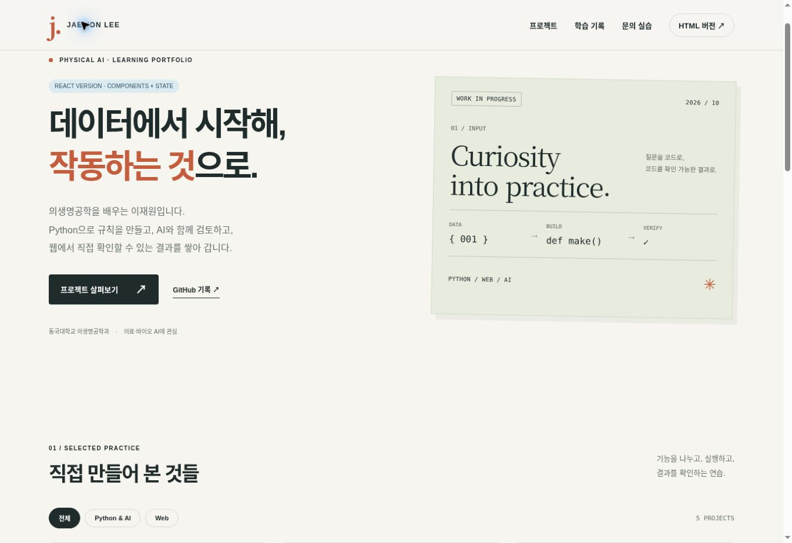

# Physical AI Learning · 이재원

**이재원 | 2026.10.26 수업 확인 기준**

데이터에서 Python, Git, AI 코드 에이전트와 웹 제작까지 이어지는 실습 저장소입니다. 날짜별 노트와 함께 실제 코드·입력 데이터·생성 결과·실행 기록을 제공합니다.

## 날짜별 실습

| 날짜 | 수업 | 실제 결과 |
| --- | --- | --- |
| 10/08 | 데이터 기초·CSV/JSON | [24개 활동 풀이·파일](labs/2026-10-08/README.md) |
| 10/14 | Python 기초 | [18개 오류 수정 활동 × 정상·오류·수정·추가 4종](labs/2026-10-14/README.md) |
| 10/15 | Python 심화 | [18개 활동·로그 검사·4개 입력 비교](labs/2026-10-15/README.md) |
| 10/16 | Git/GitHub | [실제 Git 27개 명령·충돌 해결·프로필 실습](labs/2026-10-16/README.md) |
| 10/20 | AI 코드 에이전트 | [장비 대여 프로젝트·설계·Skill·MCP](labs/2026-10-20/README.md) |
| 10/21 | HTML/CSS/React/MCP | [HTML·React 포트폴리오·검수·캡처](labs/2026-10-21/README.md) |
| **10/22** | **포트폴리오·OpenCV·YOLO·Flask** | **[웹캠 1~8단계·실제 추론·대시보드·보드 프로젝트](labs/2026-10-22/README.md)** |
| **10/23** | **ESP32 Wi-Fi·BLE·터치·원격 카메라** | **[펌웨어 8종·PC 게이트웨이·Supabase·Tailscale](labs/2026-10-23/README.md)** |
| **10/26** | **원격 비전 계측·Arduino 고급키트** | **[펌웨어 10종·대시보드·조이스틱 게임 2개](labs/2026-10-26/README.md)** |

## 과제 6개

[실행 안내와 명세 →](assignments/README.md)

- 기초: 트리, 좌석 예약·취소, 측정값 분석
- 심화: JSON 설정 도형 저장, 재실행 가능한 예약, 구역별 센서 검사 보고서

이전의 여러 트리 가로 출력 예제는 [examples/tree.py](examples/tree.py)에 남겼습니다. 공식 HW01은 높이 3~15를 재입력받고 줄기에 `|`를 사용하는 별도 구현입니다.

## 직접 실행하기

Python 3.10 이상. 기존 Python 기초 예제는 외부 패키지 없이 실행합니다. 10/22 비전 실습은 OpenCV·Flask·Ultralytics 설치가 필요하며 [별도 실행 안내](labs/2026-10-22/vision/README.md)를 따릅니다. 저장소 루트에서:

```sh
python assignments/basic/HW01_tree.py
python assignments/advanced/AH01_shapes.py
python assignments/advanced/AH03_sensor_report.py
python projects/equipment-loan/app.py list
python mcp/client_demo.py
python scripts/verify.py
```

개념별 추가 예제:

```sh
python examples/basic_concepts.py C09
python examples/advanced_concepts.py D03
```

웹은 `python -m http.server 8000` 실행 후 `http://localhost:8000/web/`로 엽니다. React 빌드본도 포함되어 버전 전환 버튼으로 비교할 수 있습니다. 수정·재빌드 방법은 [웹 README](web/README.md)에 있습니다.

## 실제 검증 결과

| 검사 | 결과 |
| --- | --- |
| Python 단위 테스트 | 21개 통과 |
| JavaScript 입력·필터 테스트 | 4개 통과 |
| 기초 오류 수정 활동 | 18개 × 4종, 72개 파일 실행 |
| 심화 활동 | 18개 실행 |
| 데이터 결과 파일 | 24개 검사 |
| 개념 예제 | C01–C17 · D01–D12 실행 |
| Git | 실제 로컬 저장소에서 명령 27개 실행 |
| MCP | stdio 초기화·도구 목록·문서 읽기·허용 목록 검사, Notion 개인 문서 생성·실제 읽기 |
| 웹 | HTML·React 필터·폼, 모바일 메뉴·Escape·가로 넘침 확인, Vite 빌드 성공 |
| 10/22 비전 추가 검증 | 단위 테스트 15개·실제 HTTP/MJPEG/SSE·촬영 통과, YOLO26n 실제 사진 CPU 추론·Chromium 화면 3개 검사·UNO/ESP32S3 컴파일 성공 |

[통합 실행 기록](evidence/validation.json) · [브라우저 기록](evidence/browser-check.json) · [로컬 MCP 요청·응답](evidence/mcp-transcript.json) · [Notion 실제 연결 확인](evidence/notion-connection.json)



[모바일 두 버전 캡처](evidence/portfolio-mobile.jpg)

## 기록과 남은 외부 작업

날짜별 개념 노트는 [notes](notes/2026-10-08.md), 프로필 README·배지·실제 실행 GIF는 [profile](profile/README.md), 검수·배포 현황은 [release](web/docs/release.md)에서 확인합니다. 자동 실행 결과를 수강·출석·사람의 짝 검토 완료로 표시하지 않습니다. 사용자 PC의 Desktop 설치·계정 프로필 게시, 실제 팀 검토는 별도 작업입니다. 외부 연결과 공개 배포의 실제 상태는 해당 실행 기록을 기준으로 확인합니다.

## 기존 프로젝트

- [MAKER MARKET · 아두이노 쇼핑몰](https://github.com/jaewonlee021111/arduino-mall)
- [PC BUILD LAB · 컴퓨터 부품 조회·견적](https://github.com/jaewonlee021111/arduino-mall/tree/main/pc-build)

## 출처

[공식 교육 사이트](https://zeusk302-png.github.io/kdigital-physical-ai/)의 10월 21일까지 공개된 6개 날짜를 기준으로 했습니다. 날짜 사이 공백이 휴강이라는 뜻은 아닙니다. 활동 명세는 [curriculum.json](curriculum.json), 원본 실습 입력과 새 풀이의 구분은 [ATTRIBUTION](ATTRIBUTION.md)에 기록했습니다. 10월 22일은 사용자가 제공한 Zoom 녹화의 자동 자막과 강사 채팅을 대조해 추가했습니다. [해당 날짜 출처·확인 범위](labs/2026-10-22/SOURCES.md)를 구분했습니다. 10월 23일 수업 진도는 포함하지 않습니다.

