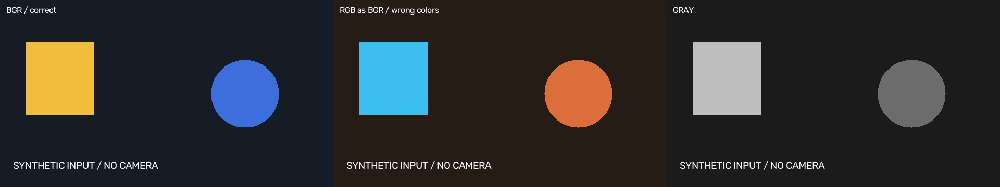

# 10월 22일 · 포트폴리오와 컴퓨터 비전

사용자가 제공한 **2026-10-22 Zoom 녹화(7:45:32)**의 자동 자막과 강사 채팅에 담긴 실습 지시를 대조해 정리했다. 날짜는 녹화 페이지 기준이다. 아래 코드는 수업 흐름에 맞춰 새로 구현한 복습 결과이며, 사용자가 수업 중 직접 수행한 작업을 증명하는 기록은 아니다.

## 오늘 한 것

1. HTML·CSS·JavaScript·React 역할과 반응형 Grid 복습.
2. 전날 기획서를 다듬고 자기소개·포트폴리오 제작. 파비콘·미리보기·GitHub Pages/Vercel 배포 방식 논의.
3. 웹캠 실습 1~8단계: 입력 → 웹 스트림 → 촬영 → OpenCV 기초 → 전처리 → YOLO 사진 탐지 → 실시간 탐지 → 로그·파이프라인 대시보드.
4. 다음 실습을 위한 USB/시리얼 도구·PlatformIO, XIAO ESP32S3 Sense·UNO 작업 공간 준비.

## 녹화에서 찾을 위치

아래는 **녹화 시작부터의 경과 시간**이다. 실제 시각과 다르며 주로 강사가 지시를 채팅에 올린 시점을 사용했다.

| 위치 | 내용 | 재구성한 결과 |
| --- | --- | --- |
| 00:34:41 이후 | 웹 역할·반응형·React, 포트폴리오 진행 안내 | [기획·디자인 판단](portfolio/BRIEF.md), [HTML](../../web/index.html)·[React 소스](../../web/react/src/main.jsx) |
| 01:45:49 / 01:51:47 | 기획서 개선, GitHub Pages/Vercel 배포 목표 | [포트폴리오 수정 범위](portfolio/BRIEF.md) |
| 04:00:25 / 04:08:07 | venv·패키지 설치 | [설치·실행 안내](vision/README.md) |
| 04:16:02 | STEP 1 웹캠·FPS·카메라 검색 | [step1_webcam.py](vision/step1_webcam.py) |
| 04:38:51 | STEP 2 Flask·MJPEG·카메라 공유 | [step2_server.py](vision/step2_server.py) |
| 04:46:51 | STEP 3 촬영·저장·썸네일 | [step3_capture.py](vision/step3_capture.py) |
| 04:52:31 | STEP 4 배열·BGR/RGB·회색·좌표 | [step4_opencv_basics.py](vision/step4_opencv_basics.py) |
| 04:56:44 | STEP 5 블러·엣지·이진화·HSV·FPS | [step5_opencv_practice.py](vision/step5_opencv_practice.py) |
| 05:02:54 | STEP 6 YOLO26n 사진 탐지·해상도 비교 | [step6_yolo_image.py](vision/step6_yolo_image.py) |
| 05:08:28 | STEP 7 실시간 탐지·샘플링·장치·클래스 | [step7_realtime_yolo.py](vision/step7_realtime_yolo.py) |
| 05:17:27~05:17:42 | STEP 8 단계 계측·XML·SSE·대시보드 | [step8_pipeline_dashboard.py](vision/step8_pipeline_dashboard.py), [공통 엔진](vision/app.py) |
| 06:09:11 이후 / 07:12:41 | XIAO ESP32S3 Sense·USB·PlatformIO·UNO 환경 준비 | [두 보드 프로젝트](firmware/README.md) |

## 구현하고 실행한 결과

| 항목 | 결과·한계 |
| --- | --- |
| 새 비전 단위 테스트 | 12개 통과: 색 순서·7개 전처리·촬영·중복 이름·경로 접근·카메라 실패·샘플링·SSE·두 클라이언트 |
| 실제 HTTP 서버 | 페이지·JS·상태·XML 메타데이터·촬영·JPEG·MJPEG·SSE 응답 확인 |
| YOLO26n CPU 사진 추론 | 공식 bus 샘플에서 사람·버스 탐지, 워밍업 제외 320/416/640 비교 |
| 합성 입력 루프 | STEP 1 10프레임, STEP 5 12프레임, STEP 7 실제 YOLO 6프레임 실행 |
| 포트폴리오 | 비전 프로젝트·10/22 이력·favicon/OG 메타데이터 추가, JS 테스트 4개 통과·React 빌드 성공 |
| 보드 | 두 설정과 최소 펌웨어 작성. 도구 다운로드 문제로 컴파일 미완료. 실제 USB 업로드 미실행 |
| 실제 카메라·GUI·GPU·브라우저 화면 | 미검증. 합성 입력과 API 검사를 실제 하드웨어 성공으로 기록하지 않음 |

[검증 JSON](evidence/validation.json) · [HTTP 결과](evidence/http-check.json) · [YOLO 측정값](evidence/yolo/yolo-benchmark.json) · [보드 빌드 상태](evidence/build-status.json)

## 실제 YOLO 측정

| imgsz | 한 번의 호출 시간, 워밍업 제외 | 탐지 수 |
| --- | --- | --- |
| 320 | 352.889 ms | 5 |
| 416 | 241.560 ms | 4 |
| 640 | 416.877 ms | 5 |

공유 CPU 환경의 단회 관측이다. 값이 단조롭게 증가하지 않는 이유를 임의로 단정하지 않으며, 성능 결론에는 여러 번 측정한 중앙값·분산과 동일한 전력·부하 조건이 필요하다. 이 수치는 사용자 PC나 실시간 카메라 FPS를 뜻하지 않는다.

## 복습할 개념과 다음 단계

자막의 오인식과 설명 중 단순화된 부분은 [개념 노트](../../notes/2026-10-22.md)에 구분했다. 특히 BGR/RGB 입력 규약, confidence와 정답 확률의 차이, 경량 모델과 양자화, 정적 호스팅의 JavaScript 지원을 정확히 정리했다.

다음 수업 예고는 ESP32 원격 카메라·초음파 센서·LED/부저다. 10/22에 이 센서들을 실제로 제어한 것으로 적지 않는다. 포트폴리오 링크 제출은 안내됐지만 이번 변경에서 외부 서비스의 새 공개 URL을 배포하거나 강사에게 링크를 전송하지는 않았다.

원본 녹화 링크·암호·전체 자막·수강생 채팅은 공개하지 않는다. [출처와 재구성 기준](SOURCES.md)을 참고한다.
