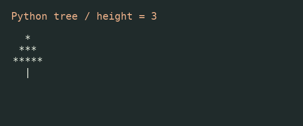

# 이재원 · Biomedical Engineering & AI

동국대학교 의생명공학과에서 공부하며 의료·바이오 AI에 관심이 있습니다.

## 배우고 만든 것
- [Physical AI 학습·실습 코드](../README.md)
- [트리·예약·측정값 분석과 심화 과제](../assignments/README.md)
- [장비 대여·반납 관리](../projects/equipment-loan/README.md)
- [HTML·React 포트폴리오](../web/README.md)

이 문서는 프로필 README 실습용 완성 파일입니다. 현재 저장소 내 문서이며, 계정명과 같은 프로필 저장소에 실제 게시되었다는 뜻은 아닙니다.
